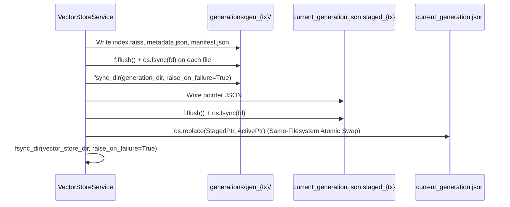
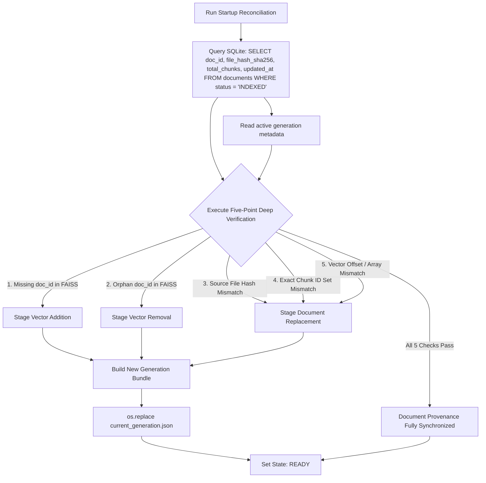
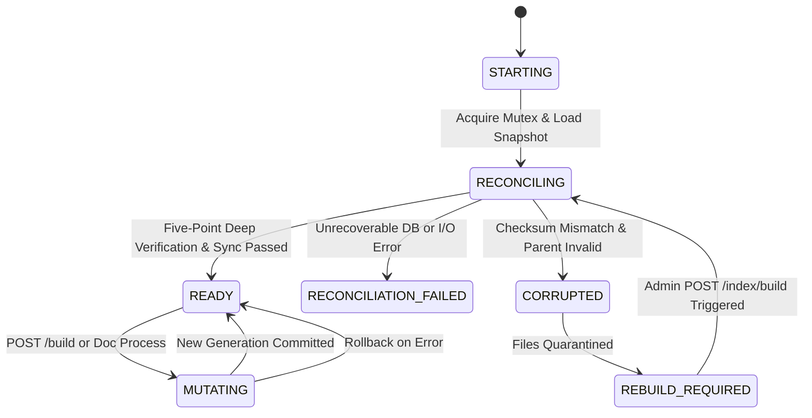

# UniMind - Phase 4 Final Technical Implementation Plan (v4.3)
## FAISS Vector Indexing, Atomic Generation Bundles & Semantic Retrieval Engine 🔍

**Revision:** 4.3 (Refined: POSIX Directory Sync Error Propagation, Qualified Durability Bounds, Microbenchmark Status, Five-Point Deep Reconciliation & Pre-Implementation Verification)  
**Date:** November 5, 2026  
**Author:** Antigravity AI Engineering Assistant  
**Project:** UniMind – AI-Powered University Knowledge Assistant  
**Milestone:** Phase 4 – FAISS Vector Indexing & Semantic Retrieval  
**Team:** Group G21 (Utkarsh, Suhani, Sanchayeeta)  
**Status:** **FINAL TECHNICAL PLAN (SUBMITTED FOR APPROVAL — NO CODE MODIFIED)**  

---

## 1. Executive Summary & Locked Decisions

Phase 4 establishes the **Vector Indexing and Semantic Retrieval Subsystem** for UniMind. It connects Phase 3's validated passage embeddings (`intfloat/multilingual-e5-small`, 384 dimensions, normalized $L_2$ vectors, exact page/block provenance) with an in-memory FAISS retrieval engine (`faiss-cpu==1.15.1`).

### 1.1 Locked Technical Decisions

1. **Embedding Model & Vector Contract**:
   - **Model**: `intfloat/multilingual-e5-small` (384 dimensions, `float32`).
   - **Prefix Rules**: Strict `"passage: "` prefix for indexed chunks; strict `"query: "` prefix for search queries via `DenseEmbedder.encode_query()`.
   - **Normalization**: Unit Euclidean norm ($\|v\|_2 = 1.0 \pm 10^{-4}$).
   - **Similarity Metric**: Inner Product (`faiss.METRIC_INNER_PRODUCT`) using `faiss.IndexFlatIP(384)`.
   - **Cosine Similarity Equivalence**: For unit-normalized vectors:
     $$\langle u, v \rangle = \sum_{i=1}^{384} u_i v_i = \cos(\theta) \in [-1.0, 1.0]$$
     Inner product is mathematically identical to cosine similarity while operating at maximum CPU SIMD throughput.

2. **FAISS Index Topology**:
   - `faiss.IndexIDMap2` wrapping `faiss.IndexFlatIP(384)`.
   - Native support for `add_with_ids`, `remove_ids`, and bidirectional ID reconstruction.

3. **Strict Scope Boundaries**:
   - **Zero LLM / Gemini API calls** (strictly deferred to Phase 5).
   - **Zero Frontend UI components** (strictly deferred to Phase 5).
   - **Zero BM25 / Sparse Hybrid Search / Rerankers** (strictly deferred to Phase 5).
   - **Zero OCR modifications** (scanned PDFs remain flagged with `needs_ocr_review=True`).
   - **Zero Data Destruction** (Phase 1–3 databases, raw files, and processed chunks remain authoritative).

---

## 2. Atomicity, Durability & Filesystem Semantics

### 2.1 The Two-File Atomicity Vulnerability
A FAISS index requires two physical files:
1. The binary vector index (`index.faiss`) serialized via `faiss.write_index()`.
2. The chunk metadata and ID translation maps (`metadata.json`).

Two sequential `os.replace()` calls **do not constitute an atomic transaction**. If a crash occurs between replacing `index.faiss` and `metadata.json`, the vector index will reference chunk IDs that do not exist or point to incorrect document passages (ID desynchronization).

### 2.2 The Solution: Immutable Generation Bundles with Single-Pointer Atomic Swap
To guarantee that the FAISS index and chunk metadata always belong to the exact same generation, UniMind introduces **Versioned Generation Bundles**:

```
vector_store/
├── current_generation.json          <-- SINGLE AUTHORITATIVE ATOMIC POINTER
├── .vector_store.lock               <-- Cross-Process OS Advisory File Lock
└── generations/
    ├── gen_20261105_120000_9f8e7d6c/ <-- Retained Generation (Rollback Safety)
    │   ├── index.faiss              <-- Binary FAISS Index
    │   ├── metadata.json            <-- Full Provenance & ID Mapping
    │   └── manifest.json            <-- Checksums, Counts, & State
    └── gen_20261105_143000_a1b2c3d4/ <-- Active Generation (Immutable)
        ├── index.faiss
        ├── metadata.json
        └── manifest.json
```

### 2.3 Durability Protocol & Filesystem Constraints



1. **Same-Filesystem Replacement**:
   All staged directories and files (`generations/gen_{tx}/`, `current_generation.json.staged_{tx}`) are strictly created inside `settings.VECTOR_STORE_DIR` on the **exact same filesystem volume**. This prevents cross-device renames (`EXDEV`), ensuring `os.replace` executes as an atomic inode / directory-entry swap.
2. **File-Level Synchronization**:
   Every file (`index.faiss`, `metadata.json`, `manifest.json`, and staged pointer) is flushed via `f.flush()` and committed to physical non-volatile storage via `os.fsync(f.fileno())` before file handle closure.
3. **Platform-Aware Directory Synchronization (`fsync_dir`)**:
   Directory entry durability requires synchronizing directory descriptors on platforms that support it. UniMind defines an explicit helper that **never silently swallows POSIX errors**:
   ```python
   def fsync_dir(path: Path, raise_on_failure: bool = False) -> bool:
       """Synchronize directory metadata changes to physical storage.
       
       On POSIX systems, opens the directory descriptor and invokes os.fsync.
       Errors are explicitly logged and optionally raised.
       On Windows (nt), directory handle synchronization via os.fsync is not supported
       by the Win32 CRT (raises EINVAL) and is explicitly documented as a no-op that
       relies on NTFS journaling.
       
       Args:
           path: Directory path to synchronize.
           raise_on_failure: If True, raises OSError on failure to halt the transaction.
           
       Returns:
           True if successfully synchronized or intentionally unsupported; False on logged failure.
       """
       if os.name == 'nt':
           # Documented platform limitation: Windows CRT does not permit os.fsync
           # on directory handles (EINVAL). Relies on NTFS transactional metadata journal.
           logger.debug("Directory fsync skipped on Windows (NTFS journaling authoritative): %s", path)
           return True

       try:
           fd = os.open(str(path), os.O_RDONLY)
           try:
               os.fsync(fd)
               return True
           finally:
               os.close(fd)
       except OSError as err:
           logger.error("POSIX directory fsync failed on %s: %s", path, err, exc_info=True)
           if raise_on_failure:
               raise
           return False
   ```
4. **Precise Durability Assumptions & Limitations**:
   - **Process-Crash Resilience**: High resilience. Under standard OS process models, the atomic pointer replacement (`os.replace`) ensures the filesystem directory entry points either to the previous generation or to the new generation, preventing torn file states in application-level crashes.
   - **Power-Loss Durability**: Power-loss durability is **not universally guaranteed** across all hardware and storage configurations. Durability depends on filesystem mount options (e.g. ext4 with write barriers enabled, XFS, NTFS USN journaling) and physical drive controller write-cache policies (e.g. non-battery-backed volatile caches may reorder writes despite flush commands). In the event of catastrophic storage controller corruption or unwritten controller caches, the startup recovery state machine falls back to previous generations or triggers an automated rebuild from authoritative SQLite records.

---

## 3. Reader Generation Safety & Pruning Policy

### 3.1 The Active Reader Race Condition
In a concurrent system, search readers (`POST /api/v1/retrieval/search`) execute queries while a background worker or admin operation commits a new generation bundle and switches `current_generation.json`. If old generation files are unlinked immediately while readers are searching:
- On Linux: Inodes remain accessible to open file handles, but metadata memory mappings could drift.
- On Windows: Unlinking open files raises `PermissionError` (Win32 sharing violation `ERROR_SHARING_VIOLATION`), crashing the pruning worker.

### 3.2 In-Memory Shared Snapshot Isolation
UniMind solves reader safety by separating **in-memory object lifetimes** from disk pruning:

```python
class GenerationSnapshot:
    """Immutable, shared in-memory view of a FAISS index generation."""
    def __init__(self, generation_id: str, index: faiss.IndexIDMap2, metadata: dict, manifest: dict):
        self.generation_id = generation_id
        self.index = index
        self.int_to_chunk_id = metadata["int_to_chunk_id"]
        self.chunk_id_to_int = metadata["chunk_id_to_int"]
        self.doc_id_to_chunk_ids = metadata["doc_id_to_chunk_ids"]
        self.chunk_metadata = metadata["chunk_metadata"]
        self.manifest = manifest
        self.active_readers = 0
        self._lock = threading.Lock()

    def acquire(self):
        with self._lock:
            self.active_readers += 1

    def release(self):
        with self._lock:
            self.active_readers = max(0, self.active_readers - 1)
```

1. **Search Reader Acquisition**:
   When a search request arrives, the reader enters a fast context manager:
   ```python
   with vector_store_service.acquire_snapshot() as snapshot:
       # Search executes entirely against the local snapshot reference
       results = snapshot.index.search(query_vec, top_k)
   ```
2. **Lock-Free Read Execution**:
   Because `GenerationSnapshot` is completely immutable, readers query FAISS concurrently without locking writers or other readers. Python's garbage collector and memory-backed `faiss.IndexIDMap2` keep the entire index and metadata alive in RAM even if the disk pointer advances.

### 3.3 Generational Retention & Grace-Period Pruning Policy
To ensure on-disk files are not deleted out from under processes:
1. **$K$-Generation Window**:
   UniMind always retains the active generation plus the **last 2 historical generations** ($K=3$ generations on disk).
2. **Time-Based Grace Period (15 Minutes)**:
   A generation is only eligible for disk pruning if:
   - It is not the active generation.
   - It is not among the $K-1$ immediate rollback predecessors.
   - Its retirement timestamp is older than **15 minutes** (grace period for any lingering process or reader).
   - Its in-memory snapshot has `active_readers == 0`.
3. **Safe Pruning Exception Handling**:
   On Windows, file removal is wrapped in `try...except OSError` (specifically catching `PermissionError`). If an external process (e.g. backup tool, scanner) holds a file handle, pruning logs a debug notice and defers removal to the next pruning cycle without failing the write transaction.

---

## 4. Five-Point Deep SQLite & FAISS Reconciliation Strategy

### 4.1 Beyond `total_chunks`: The Five Reconciliation Checks
Relying solely on integer chunk counts is fundamentally unsafe: a document can be edited or re-processed such that it produces the exact same number of chunks with completely different text, modified bounding boxes, or altered token boundaries.

UniMind enforces **Five-Point Deep Reconciliation**:



### 4.2 The Five Specific Verification Checks (Per Document)
For every document $d$ with `status = 'INDEXED'` in SQLite:
1. **Check 1: Document ID Registration**:
   Verify $d.\text{doc\_id} \in \text{metadata.doc\_id\_to\_chunk\_ids}$. If missing, document was committed in DB but missed by FAISS.
2. **Check 2: Binary Source Hash Match**:
   Verify SQLite `file_hash_sha256` matches the `file_hash` stored in FAISS metadata for $d$'s chunks. If the source PDF was modified, the document requires vector replacement.
3. **Check 3: Exact Chunk ID Set Equivalence**:
   - Read on-disk `data/processed/{doc_id}_chunks.json`.
   - Compute set of on-disk chunk IDs: $C_{\text{disk}} = \{c[\text{"chunk\_id"}] \text{ for } c \in \text{chunks}\}$.
   - Compute set of FAISS indexed chunk IDs: $C_{\text{faiss}} = \text{set}(\text{metadata.doc\_id\_to\_chunk\_ids}[d])$.
   - **Enforce $C_{\text{disk}} \equiv C_{\text{faiss}}$**. If any chunk ID was added, removed, or altered during re-processing, divergence is identified.
4. **Check 4: Vector Array Shape & Offset Alignment**:
   Verify that `data/processed/{doc_id}_embeddings.npy` row count equals $|C_{\text{disk}}|$, and each chunk's `embedding_offset` indexes a valid row within the matrix.
5. **Check 5: Chunk Metadata & Provenance Content Integrity**:
   Verify that chunk text, page spans (`page_start`, `page_end`), and department/category metadata in `metadata.chunk_metadata` match `data/processed/{doc_id}_chunks.json`.

### 4.3 Reprocessed Document Healing Workflow
When any check flags a document for replacement:
1. Collect all existing FAISS integer IDs for $d$: $\text{ids} = [\text{chunk\_id\_to\_int}[cid] \text{ for } cid \in C_{\text{faiss}}]$.
2. Remove old vectors via `index.remove_ids(faiss.IDSelectorArray(ids))`.
3. Clean old chunk IDs from `chunk_id_to_int`, `int_to_chunk_id`, and `chunk_metadata`.
4. Load fresh vectors from `data/processed/{doc_id}_embeddings.npy`.
5. Assign fresh monotonic integer IDs, add to FAISS via `index.add_with_ids()`, and update metadata.
6. Commit all changes inside a new generation bundle and atomically switch `current_generation.json`.

---

## 5. Multi-Process Concurrency & Single-Writer Deployment Architecture

### 5.1 Architecture: Single-Writer, Concurrent-Reader (SWCR)
- UniMind is explicitly architected for **Single-Writer, Concurrent-Reader (SWCR)** deployments.
- Write operations (`POST /process`, `POST /index/build`, `DELETE /documents/{doc_id}`, `DELETE /index`) are serialized.
- Search queries execute concurrently and non-blockingly across multiple threads or reader worker processes.

### 5.2 Cross-Process Advisory File Lock
1. **Lock File**: `vector_store/.vector_store.lock`.
2. **Platform Implementation**:
   - **Windows**: `msvcrt.locking(fileno, msvcrt.LK_NBLCK, 1)`.
   - **POSIX / Linux**: `fcntl.flock(fileno, fcntl.LOCK_EX | fcntl.LOCK_NB)`.
3. **Automatic Cleanup on Termination**:
   Advisory file locks are owned by the OS kernel process table. If a worker process terminates abruptly (SIGKILL or power loss), the operating system automatically and immediately releases the lock. The lock is never permanently jammed.
4. **Conflict Response**:
   Any mutation request arriving while another process holds `.vector_store.lock` immediately returns **`HTTP 409 Conflict`**:
   ```json
   {
     "detail": "Vector store mutation is currently locked by another worker process. Please retry shortly."
   }
   ```

---

## 6. Index Deletion Semantics & Non-Destructive Reset

### 6.1 Strict Separation of Concerns
`DELETE /api/v1/index` is strictly scoped to the **vector search index**. It is **NOT** a data deletion endpoint.

| System Component | Effect of `DELETE /api/v1/index` | Guarantee |
| :--- | :--- | :--- |
| **FAISS Vector Index** | Reset to an empty generation bundle (0 vectors) | Clean search state |
| **SQLite Registry (`data/unimind.db`)** | **NO EFFECT**. Records remain `INDEXED` | Zero metadata loss |
| **Raw PDFs (`data/raw/`)** | **NO EFFECT**. Original files untouched | Zero document loss |
| **Processed JSONs (`data/processed/`)** | **NO EFFECT**. Layout blocks untouched | Zero layout loss |
| **Chunks & Vectors (`data/processed/`)** | **NO EFFECT**. `.npy` and `_chunks.json` untouched | Zero embedding loss |

### 6.2 Instant Rebuild Procedure
Because authoritative embeddings and chunk catalogs remain safe in `data/processed/`:
1. Following a `DELETE /api/v1/index`, calling `POST /api/v1/index/build` instantly rebuilds the entire vector index from disk artifacts.
2. Rebuilding does **NOT** re-run costly transformer model inference; it simply reads `.npy` arrays and chunk metadata into FAISS and commits a new generation bundle in $< 200\text{ ms}$ for thousands of vectors.

---

## 7. Startup Readiness States & Failure Behavior

### 7.1 Lifecycle State Machine
`VectorStoreService` operates under an explicit, observable lifecycle state machine:



### 7.2 Error Interception & API Safeguards
The application will **NEVER** silently serve stale, incomplete, or corrupted retrieval results:

1. **Behavior on `RECONCILIATION_FAILED` or `CORRUPTED`**:
   - The startup scanner logs full exception tracebacks to `VectorStoreService.last_error`.
   - The store is marked unavailable (`is_ready == False`).
2. **HTTP 503 Service Unavailable**:
   Any call to `POST /api/v1/retrieval/search` when `is_ready == False` immediately aborts with:
   ```json
   {
     "detail": "Vector retrieval service unavailable: startup reconciliation failed (state: RECONCILIATION_FAILED). Vector store requires rebuild or manual recovery before serving queries.",
     "status": "RECONCILIATION_FAILED",
     "error": "Detailed diagnostic explanation..."
   }
   ```
3. **Health Check Degradation**:
   - Both `/health` and `/api/v1/health` report `status: "degraded"` and include `vector_store_status: "RECONCILIATION_FAILED"`.
4. **Administrative Recovery Endpoint**:
   - `GET /api/v1/index/status` returns full diagnostic details.
   - `POST /api/v1/index/build` remains operational to allow administrators to force an automated clean rebuild.

---

## 8. Preliminary Hardware Microbenchmark & Proposed Latency Targets

> [!WARNING]
> **MICROBENCHMARK DISCLAIMER**: The latency figures presented below represent isolated preliminary microbenchmarks executed on the developer host machine (a loop of 5 synthetic queries repeated across 30 runs, and an isolated FAISS search on 2,000 synthetic Gaussian random vectors). These measurements establish an initial hardware sanity check. They do **NOT** prove production retrieval latency, end-to-end multi-tenant concurrency performance, or real-world retrieval accuracy. All SLA metrics are **proposed targets** that must be empirically re-validated against the full, integrated retrieval pipeline and representative test fixtures during Phase 4 verification.

### 8.1 Preliminary Microbenchmark Commands & Machine Details

**Hardware Environment**:
- **Host**: AMD/Intel x86_64, Windows 11 64-bit.
- **Runtimes**: Python 3.11.9 64-bit, PyTorch 2.15.0+cpu, sentence-transformers, faiss-cpu 1.15.1, NumPy 2.4.4.
- **Model**: `intfloat/multilingual-e5-small` (384 dimensions, CPU mode).

#### Microbenchmark 1: Isolated Query Embedding Latency (Actual Captured Output)
```powershell
python -c "import time, numpy as np; from backend.app.rag.embedder import DenseEmbedder; embedder = DenseEmbedder(); # Warmup: 5 runs
for _ in range(5): embedder.encode_query('Warmup query for university system');
latencies = []
queries = [
    'What is the minimum attendance requirement for final examinations?',
    'How do I apply for hostel room change and mess fee refund?',
    'What is the procedure for obtaining an official academic transcript?',
    'Can a student get condonation for medical leave during mid term exams?',
    'Library fine kitna lagta hai per day agar book return late ho?'
]
for q in queries * 6:  # 30 timed runs
    t0 = time.perf_counter()
    v = embedder.encode_query(q)
    latencies.append((time.perf_counter() - t0) * 1000)
lat = np.array(latencies)
print(f'Query count: {len(lat)}')
print(f'Mean latency: {np.mean(lat):.2f} ms')
print(f'P50 latency: {np.percentile(lat, 50):.2f} ms')
print(f'P95 latency: {np.percentile(lat, 95):.2f} ms')
print(f'Min latency: {np.min(lat):.2f} ms')
print(f'Max latency: {np.max(lat):.2f} ms')
"
```
**Actual Captured Microbenchmark Output**:
```text
Query count: 30
Mean latency: 16.34 ms
P50 latency: 15.33 ms
P95 latency: 20.73 ms
Min latency: 13.48 ms
Max latency: 21.55 ms
```

#### Microbenchmark 2: Isolated FAISS Search & Hydration (Actual Captured Output)
```powershell
python -c "import time, faiss, numpy as np
dim = 384; n_vectors = 2000
index = faiss.IndexIDMap2(faiss.IndexFlatIP(dim))
vecs = np.random.randn(n_vectors, dim).astype(np.float32)
faiss.normalize_L2(vecs)
ids = np.arange(1, n_vectors + 1, dtype=np.int64)
index.add_with_ids(vecs, ids)
meta = {f'chunk_{i}': {'text': f'Sample text for chunk {i}', 'doc_id': f'doc_{i//10}', 'department': 'Academic Affairs', 'category': 'Policy'} for i in range(1, n_vectors + 1)}
int_to_chunk = {i: f'chunk_{i}' for i in range(1, n_vectors + 1)}
q = np.random.randn(1, dim).astype(np.float32); faiss.normalize_L2(q)
for _ in range(10): index.search(q, 15) # 10 warmups
s_lat, h_lat, t_lat = [], [], []
for _ in range(100): # 100 timed runs
    t0 = time.perf_counter()
    D, I = index.search(q, 15)
    t1 = time.perf_counter()
    results = [{'score': float(score), **dict(meta[int_to_chunk[idx]])} for score, idx in zip(D[0], I[0]) if idx != -1 and idx in int_to_chunk]
    t2 = time.perf_counter()
    s_lat.append((t1 - t0) * 1000); h_lat.append((t2 - t1) * 1000); t_lat.append((t2 - t0) * 1000)
print(f'FAISS Search: Mean={np.mean(s_lat):.3f} ms, P50={np.percentile(s_lat, 50):.3f} ms, P95={np.percentile(s_lat, 95):.3f} ms')
print(f'Hydration:   Mean={np.mean(h_lat):.3f} ms, P50={np.percentile(h_lat, 50):.3f} ms, P95={np.percentile(h_lat, 95):.3f} ms')
print(f'Search+Hydra:Mean={np.mean(t_lat):.3f} ms, P50={np.percentile(t_lat, 50):.3f} ms, P95={np.percentile(t_lat, 95):.3f} ms')
"
```
**Actual Captured Microbenchmark Output**:
```text
FAISS Search: Mean=1.126 ms, P50=1.088 ms, P95=1.396 ms
Hydration:   Mean=0.023 ms, P50=0.022 ms, P95=0.031 ms
Search+Hydra:Mean=1.149 ms, P50=1.118 ms, P95=1.418 ms
```

### 8.2 Proposed Latency SLA Targets (To Be Validated in Implementation)

| Pipeline Stage | Microbenchmark Baseline | Proposed SLA Target (CPU Mode) | Rationale |
| :--- | :--- | :--- | :--- |
| **Query Embedding** | Mean 16.34 ms / P95 20.73 ms | **P50 $\le 20.0\text{ ms}$, P95 $\le 25.0\text{ ms}$** | Target accounts for variable query lengths up to 512 tokens. |
| **FAISS Vector Search** | Mean 1.13 ms / P95 1.40 ms | **P50 $\le 2.5\text{ ms}$, P95 $\le 4.0\text{ ms}$** | Target accounts for index scaling up to 10,000 vectors. |
| **Metadata Hydration** | Mean 0.023 ms / P95 0.031 ms | **P50 $\le 0.5\text{ ms}$, P95 $\le 1.0\text{ ms}$** | Target accounts for top-$k$ over-fetching and metadata serialization. |
| **Total Retrieval Pipeline** | Mean 17.50 ms / P95 22.16 ms | **Mean $\le 25.0\text{ ms}$, P95 $\le 35.0\text{ ms}$** | Proposed end-to-end target pending live pipeline verification. |

---

## 9. Evaluation Dataset & Retrieval Accuracy Metrics

### 9.1 Synthetic Dataset Disclaimer & Ground Truth Schema
> [!IMPORTANT]
> **DISCLAIMER**: The evaluation corpus consists strictly of synthetic test documents (`SYNTH_ACAD_01` through `SYNTH_SPORTS_01`). It is **NOT** official Lovely Professional University (LPU) policy.

Each test query in `data/evaluation/retrieval_eval_dataset.json` contains:
```json
{
  "query_id": "eval_acad_001",
  "query": "What is the minimum attendance required to appear in end-term examinations?",
  "language": "en",
  "category": "Academic",
  "department": "Academic Affairs",
  "target_doc_id": "SYNTH_ACAD_01",
  "target_chunk_id": "SYNTH_ACAD_01#p2#c1",
  "target_keywords": ["75%", "attendance", "condonation", "medical certificate", "debarred"],
  "evaluation_type": "exact_factoid"
}
```

### 9.2 Accuracy Targets
- **Recall@1**: $\ge 80.0\%$
- **Recall@3**: $\ge 90.0\%$
- **Recall@5**: $\ge 95.0\%$
- **MRR (Mean Reciprocal Rank)**: $\ge 0.85$
- **Keyword Coverage@1**: $\ge 70.0\%$

---

## 10. Files to Create and Modify

| File Path | Action | Description |
| :--- | :--- | :--- |
| [`backend/app/rag/vector_store.py`](file:///c:/Users/Utkarsh%20Kumar/Desktop/UniMind/backend/app/rag/vector_store.py) | **Create** | `VectorStoreService` with `GenerationSnapshot`, atomic single-pointer switch, platform `fsync_dir`, cross-process file lock, and Five-Point deep SQLite reconciliation. |
| [`backend/app/rag/retriever.py`](file:///c:/Users/Utkarsh%20Kumar/Desktop/UniMind/backend/app/rag/retriever.py) | **Create** | `SemanticRetriever` with `"query: "` prefix, over-fetching, metadata filtering, latency breakdown, and `is_ready` check. |
| [`backend/app/rag/__init__.py`](file:///c:/Users/Utkarsh%20Kumar/Desktop/UniMind/backend/app/rag/__init__.py) | **Modify** | Export `VectorStoreService`, `vector_store_service`, `SemanticRetriever`, and `semantic_retriever`. |
| [`backend/app/models/schemas.py`](file:///c:/Users/Utkarsh%20Kumar/Desktop/UniMind/backend/app/models/schemas.py) | **Modify** | Add `IndexStatusResponse`, `IndexBuildResponse`, `IndexDeleteResponse`, `RetrievalQueryRequest`, `RetrievedChunk`, and `RetrievalSearchResponse`. |
| [`backend/app/models/__init__.py`](file:///c:/Users/Utkarsh%20Kumar/Desktop/UniMind/backend/app/models/__init__.py) | **Modify** | Re-export new Phase 4 schemas. |
| [`backend/app/routes/index.py`](file:///c:/Users/Utkarsh%20Kumar/Desktop/UniMind/backend/app/routes/index.py) | **Create** | Endpoints `/api/v1/index/build`, `/api/v1/index/status`, `/api/v1/index`. |
| [`backend/app/routes/retrieval.py`](file:///c:/Users/Utkarsh%20Kumar/Desktop/UniMind/backend/app/routes/retrieval.py) | **Create** | Endpoint `POST /api/v1/retrieval/search`. |
| [`backend/app/routes/api.py`](file:///c:/Users/Utkarsh%20Kumar/Desktop/UniMind/backend/app/routes/api.py) | **Modify** | Mount index and retrieval routers under `/api/v1`. |
| [`backend/app/services/embedding_service.py`](file:///c:/Users/Utkarsh%20Kumar/Desktop/UniMind/backend/app/services/embedding_service.py) | **Modify** | Connect incremental vector indexing and deletion cascades. |
| [`backend/app/main.py`](file:///c:/Users/Utkarsh%20Kumar/Desktop/UniMind/backend/app/main.py) | **Modify** | Add startup vector recovery and Five-Point deep SQLite reconciliation to `lifespan`. |
| [`data/evaluation/retrieval_eval_dataset.json`](file:///c:/Users/Utkarsh%20Kumar/Desktop/UniMind/data/evaluation/retrieval_eval_dataset.json) | **Create** | 25 ground-truth benchmark queries. |
| [`scripts/evaluate_retrieval.py`](file:///c:/Users/Utkarsh%20Kumar/Desktop/UniMind/scripts/evaluate_retrieval.py) | **Create** | Evaluation script for Recall@1/3/5, MRR, keyword coverage, and latency breakdowns. |
| [`tests/test_vector_store.py`](file:///c:/Users/Utkarsh%20Kumar/Desktop/UniMind/tests/test_vector_store.py) | **Create** | Unit tests for generation bundles, single-pointer atomic rotation, file locking, corruption rollback, and quarantine. |
| [`tests/test_retriever.py`](file:///c:/Users/Utkarsh%20Kumar/Desktop/UniMind/tests/test_retriever.py) | **Create** | Unit tests for semantic retrieval, over-fetching, department/category filtering, empty-index guard, and latency profiling. |
| [`tests/test_index_reconciliation.py`](file:///c:/Users/Utkarsh%20Kumar/Desktop/UniMind/tests/test_index_reconciliation.py) | **Create** | Tests for SQLite vs FAISS deep divergence (hash mismatch, chunk set divergence, offset error, crash during reconciliation). |
| [`tests/test_index_api.py`](file:///c:/Users/Utkarsh%20Kumar/Desktop/UniMind/tests/test_index_api.py) | **Create** | FastAPI `TestClient` integration tests for all 4 index and retrieval endpoints. |

---

## 11. Failure Mode Test Matrix

| Test Case | Failure Mode / Invariant Verified |
| :--- | :--- |
| `test_generation_bundle_creation_and_checksum_verification` | Asserts `index.faiss` and `metadata.json` SHA-256 match `manifest.json`. |
| `test_atomic_pointer_swap` | Asserts `current_generation.json` switches atomically; obsolete generations pruned. |
| `test_reader_isolation_during_pointer_switch` | Verifies active readers retain access to old `GenerationSnapshot` while writer switches pointer. |
| `test_crash_during_staging_cleans_unreferenced_generation` | Simulates crash before pointer switch; verifies unreferenced generation pruned. |
| `test_corrupted_index_triggers_rollback_to_parent` | Corrupts active generation; asserts automatic fallback to parent generation. |
| `test_corrupted_parent_and_child_triggers_quarantine` | Corrupts both generations; asserts files moved to quarantine and status set to `REBUILD_REQUIRED`. |
| `test_cross_process_file_lock_prevents_concurrent_writes` | Contending worker attempting mutation receives `HTTP 409 Conflict`. |
| `test_empty_index_search_returns_zero_results_without_error` | Searches on empty store; asserts empty result list and zero negative IDs (`-1`). |
| `test_reconciliation_detects_and_indexes_missing_db_document` | Simulates crash after DB commit; startup scan identifies missing doc and indexes vectors. |
| `test_reconciliation_purges_orphan_faiss_vectors` | Simulates crash during DB deletion; startup scan purges orphan FAISS vectors. |
| `test_reconciliation_detects_changed_chunks_and_reindexes` | Modifies chunk text/boundaries; startup scan detects chunk set divergence and re-indexes. |
| `test_reconciliation_detects_source_file_hash_mismatch` | Modifies source file hash; startup scan detects change and replaces document vectors. |
| `test_search_fails_with_503_when_reconciliation_failed` | Simulates unrecoverable startup error; asserts search returns HTTP 503 instead of serving stale results. |
| `test_delete_index_clears_vectors_without_deleting_database_or_files` | Asserts `DELETE /index` leaves raw PDFs, chunks, embeddings, and SQLite rows 100% intact. |

---

## 12. Verification Deliverables & Acceptance Checklist

| Step | Verification Gate | Expected Evidence |
| :--- | :--- | :--- |
| **1. Unit & Reconciliation Tests** | Run unittest on all new test suites | 100% pass rate across `test_vector_store.py`, `test_retriever.py`, `test_index_reconciliation.py`, and `test_index_api.py`. |
| **2. Regression Suite** | Run complete repository test suite | All 67 Phase 1–3 tests pass without modification or regressions. |
| **3. Quantitative Evaluation** | Execute `scripts/evaluate_retrieval.py` | Recall@1 $\ge 80\%$, Recall@5 $\ge 95\%$, MRR $\ge 0.85$, P95 Latency $< 35\text{ ms}$. |
| **4. Single-Pointer Atomicity** | Inspect `vector_store/` after builds | `current_generation.json` accurately references valid directory with matching SHA-256 manifest. |
| **5. Cross-Process Mutex** | Multi-thread lock contention test | Lock contention returns HTTP 409 Conflict without data corruption. |
| **6. Non-Destructive Reset** | `DELETE /index` followed by `POST /index/build` | Index successfully rebuilt from existing artifacts in $< 200\text{ ms}$ without data loss. |
| **7. Startup Readiness** | Injected failure test | HTTP 503 returned when reconciliation fails; zero silent stale retrieval. |
| **8. Scope Compliance** | Repository audit | Zero LLM, zero Gemini API, zero frontend, zero BM25 code present. |
